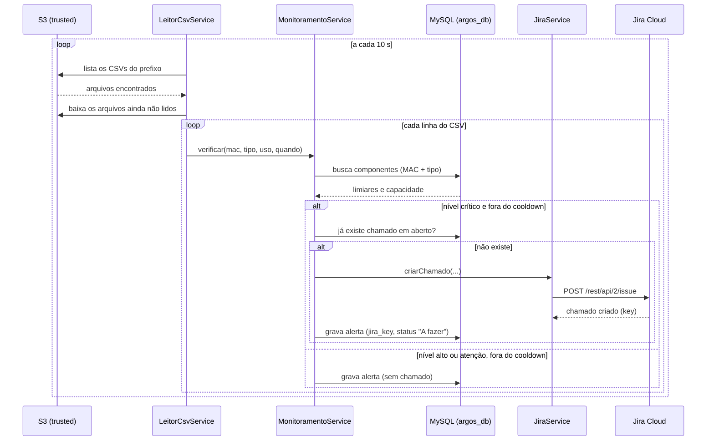
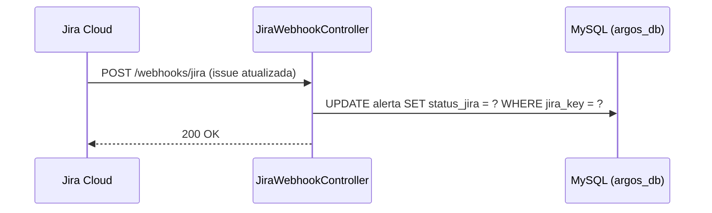

# java-jira · Alertas de hardware do Argos

Serviço em **Java / Spring Boot** que lê as métricas das máquinas monitoradas, compara com os limites cadastrados no banco, **registra cada alerta na tabela `alerta`** e **abre automaticamente um chamado no Jira** quando um componente (CPU, RAM, disco ou rede) passa do limite crítico. O status do chamado é mantido em sincronia com o Jira por meio de um **webhook**.

Ele é a última etapa do pipeline de monitoramento do projeto **Argos**: os scripts de Python coletam os dados, o ETL os trata, e este serviço transforma os dados em alertas.

---

## Sumário

1. [Visão geral](#1-visão-geral)
2. [Arquitetura e fluxo](#2-arquitetura-e-fluxo)
3. [Tecnologias](#3-tecnologias)
4. [Estrutura do projeto](#4-estrutura-do-projeto)
5. [Como o código funciona](#5-como-o-código-funciona)
6. [Regras de negócio](#6-regras-de-negócio)
7. [Contrato de dados (S3 e CSV)](#7-contrato-de-dados-s3-e-csv)
8. [Banco de dados](#8-banco-de-dados)
9. [Configuração](#9-configuração)
10. [Webhook do Jira](#10-webhook-do-jira)
11. [Como executar](#11-como-executar)
12. [Como testar um alerta](#12-como-testar-um-alerta)
13. [Problemas comuns](#13-problemas-comuns)
14. [Limitações conhecidas e melhorias](#14-limitações-conhecidas-e-melhorias)
15. [Repositórios relacionados](#15-repositórios-relacionados)

---

## 1. Visão geral

| | |
|---|---|
| **O que faz** | Lê CSVs de métricas no S3, classifica o nível de cada métrica, grava os alertas no banco e abre chamados no Jira para os alertas críticos |
| **Gatilho** | Execução agendada a cada 10 segundos (configurável) |
| **Entrada** | CSVs da camada **trusted** do bucket S3 e eventos do webhook do Jira |
| **Consulta e escrita** | Banco MySQL `argos_db`: lê limites e capacidade (`componente`) e grava/atualiza a tabela `alerta` |
| **Saída** | Chamado no Jira (API REST v2) e registros na tabela `alerta` |
| **Interface** | Sem tela. Expõe um único endpoint, `POST /webhooks/jira`, na porta **8081** |

O fluxo principal roda em segundo plano: o serviço consulta o S3 periodicamente e reage aos arquivos novos que aparecem. O único endpoint HTTP existe para o Jira avisar quando o status de um chamado muda.

---

## 2. Arquitetura e fluxo

### Pipeline completo do Argos

```
monitoring-scripts        ETL                      java-jira (este repo)
(captura.py)              (etlTrusted.py)
      │                        │                          │
      ▼                        ▼                          ▼
 S3 raw/...  ───────►  S3 trusted/...  ───────►  lê CSV → classifica nível → grava alerta → abre chamado
                                                          │            ▲            ▲
                                                          ▼            │            │
                                                      Jira Cloud    MySQL (argos_db) │
                                                          │                         │
                                                          └──── webhook (status) ───┘
```

### O que acontece a cada ciclo



### Atualização do status do chamado



---

## 3. Tecnologias

| Item | Versão / detalhe |
|---|---|
| Java | 21 |
| Spring Boot | 4.1.1 (`spring-boot-starter-jdbc`, `spring-boot-starter-webmvc`) |
| Build | Maven (wrapper incluso: `mvnw` / `mvnw.cmd`) |
| Banco | MySQL 8, via `mysql-connector-j` e `JdbcTemplate` |
| AWS | AWS SDK v2 para Java, módulo `s3` (2.27.21), região `us-east-1` |
| Jira | API REST v2, chamada com `RestTemplate` e autenticação Basic (e-mail + API token) |
| Lombok | Usado no modelo (`@Data`, `@AllArgsConstructor`) |
| Docker | Build em duas etapas: `maven:3.9.9-amazoncorretto-21` (compila) e `amazoncorretto:21-alpine` (executa) |

---

## 4. Estrutura do projeto

```
java-jira/
├── pom.xml
├── Dockerfile                           # Imagem do serviço (porta 8081, fuso America/Sao_Paulo)
├── .dockerignore
├── mvnw / mvnw.cmd                      # Maven wrapper (não precisa instalar o Maven)
└── src/main/
    ├── java/com/argos/argos/
    │   ├── ArgosApplication.java        # Ponto de entrada (@EnableScheduling)
    │   ├── client/
    │   │   └── S3Provider.java          # Cria o cliente do S3
    │   ├── controller/
    │   │   └── JiraWebhookController.java  # Recebe o webhook do Jira (POST /webhooks/jira)
    │   ├── model/
    │   │   └── Componente.java          # Componente monitorado e seus limites
    │   ├── repository/
    │   │   ├── ComponenteRepository.java  # Consulta os componentes no MySQL
    │   │   └── AlertaRepository.java    # Grava alertas e atualiza o status dos chamados
    │   └── service/
    │       ├── LeitorCsvService.java    # Lê os CSVs do S3 (agendado)
    │       ├── MonitoramentoService.java  # Classificação do nível, cooldown e decisão de abrir chamado
    │       └── JiraService.java         # Abre o chamado no Jira
    └── resources/
        ├── application.properties       # Configuração real (NÃO vai para o Git)
        └── application-example.properties  # Modelo de configuração
```

---

## 5. Como o código funciona

### `ArgosApplication`
Inicia o Spring Boot. A anotação `@EnableScheduling` é o que faz o `@Scheduled` do leitor funcionar.

### `S3Provider`
Monta o `S3Client` na região `us-east-1`. As credenciais **não ficam no código**: o SDK procura na ordem padrão da AWS (variáveis de ambiente `AWS_ACCESS_KEY_ID`, `AWS_SECRET_ACCESS_KEY` e `AWS_SESSION_TOKEN`, ou o arquivo `~/.aws/credentials` criado pelo `aws configure`).

### `LeitorCsvService` (a porta de entrada dos dados)
- Roda com `@Scheduled(fixedDelayString = "${leitor.intervalo-ms:10000}")`. Com `fixedDelay`, uma nova varredura só começa depois que a anterior terminou.
- Lista os objetos do bucket com o prefixo configurado e considera só os que terminam em `.csv`.
- Guarda em memória as chaves dos arquivos já lidos (`arquivosProcessados`) para não reler o mesmo arquivo a cada ciclo.
- Para cada arquivo: pula o cabeçalho e lê as linhas, separando as colunas **por posição** (formato fixo de 13 colunas, veja a [seção 7](#7-contrato-de-dados-s3-e-csv)).
- Para cada linha, chama o `MonitoramentoService` quatro vezes: CPU, RAM, Disco e Rede.
- Linhas com menos de 13 colunas são ignoradas, com uma mensagem no console. Valores vazios ou inválidos viram `null` e a métrica é ignorada.

### `MonitoramentoService` (a regra do alerta)
- Método `verificar(mac, tipo, uso, quando)`.
- Busca no banco os componentes daquele dispositivo (pelo MAC) e tipo. Se não houver nenhum, avisa **uma única vez** por combinação MAC + tipo e ignora as leituras.
- `classificarNivel` compara o uso com os limiares do componente e devolve `critico`, `alto`, `atencao` ou `null` (estável), sempre do mais grave para o menos grave.
- Aplica o **cooldown** por componente e nível (veja a [seção 6](#6-regras-de-negócio)).
- Calcula o valor e a unidade exibidos (sempre `%`, veja a [seção 6](#6-regras-de-negócio)).
- **Nível crítico:** se já existe chamado em aberto para o componente, não abre outro. Caso contrário, chama o `JiraService` e, se o chamado foi criado, grava o alerta com a chave do Jira e o status `A fazer`.
- **Níveis alto e atenção:** só gravam o alerta no banco, sem abrir chamado.

### `AlertaRepository`
- `possuiChamadoEmAberto(fkComponente)`: conta alertas do componente que tenham `jira_key` e cujo `status_jira` seja `a fazer` ou `em andamento` (sem diferenciar maiúsculas de minúsculas).
- `salvarAlerta(...)`: insere na tabela `alerta` com `INSERT IGNORE`. O horário registrado (`registrado_em`) é o da coleta; se ele estiver vazio ou fora do formato `yyyy-MM-dd HH:mm:ss`, usa o horário atual.
- `atualizarStatusPorJiraKey(jiraKey, status)`: atualiza o `status_jira` de todos os alertas com aquela chave. É o que o webhook chama.

### `ComponenteRepository`
Uma única consulta, `buscarPorMacETipo(mac, tipo)`, que junta `componente`, `dispositivo` e `tipo_componente` e devolve os componentes **ativos** com capacidade e os três limiares. Retorna uma lista, porque um dispositivo pode ter mais de um componente do mesmo tipo (ex.: duas CPUs).

### `JiraService`
Monta o corpo do chamado e faz `POST {jira.url}/rest/api/2/issue` com autenticação Basic (e-mail + token). Retorna a **chave do chamado** (ex.: `ARG-12`) se criou e `null` se falhou. A chave é gravada no alerta e o `null` evita que o cooldown seja registrado sem chamado criado.

### `JiraWebhookController`
Recebe `POST /webhooks/jira`, lê `issue.key` e `issue.fields.status.name` do corpo e atualiza o `status_jira` dos alertas correspondentes. Detalhes na [seção 10](#10-webhook-do-jira).

---

## 6. Regras de negócio

### Níveis de alerta
O uso é comparado com os limiares do componente, do mais grave para o menos grave:

| Condição | Nível | O que acontece |
|---|---|---|
| `uso > limiar_critico` | `critico` | Grava o alerta **e abre chamado no Jira** (se não houver um em aberto) |
| `uso > limiar_alto` | `alto` | Só grava o alerta no banco |
| `uso > limiar_atencao` | `atencao` | Só grava o alerta no banco |
| nenhum dos anteriores | estável | Apenas uma mensagem no console |

Um limiar que esteja `NULL` no banco é simplesmente ignorado.

### Cooldown (anti-duplicidade)
Sem controle, uma máquina em estado ruim por vários minutos geraria um registro a cada leitura. Por isso, depois de registrar um alerta de um nível para um componente, o serviço **só registra outro do mesmo nível para o mesmo componente após o tempo definido em `monitoramento.cooldown-minutos`** (recomendado: 30).

- O cooldown é por **componente e nível**, não por máquina.
- No nível crítico, só começa a contar se o chamado foi criado no Jira (ou se já havia um em aberto). Se o Jira estiver fora do ar, a próxima leitura crítica tenta de novo.
- Fica em memória: reiniciar o serviço zera o cooldown.

### Chamado em aberto (anti-duplicidade no Jira)
Antes de abrir um chamado crítico, o serviço consulta a tabela `alerta`. Se o componente já tem um alerta com chamado cujo status seja **`A fazer`** ou **`Em andamento`**, nenhum chamado novo é aberto, mesmo passado o cooldown. Depois que o chamado muda para outro status (por exemplo, concluído), um novo alerta crítico volta a abrir chamado.

Isso depende de o status do chamado chegar ao banco, o que é feito pelo [webhook](#10-webhook-do-jira), e de os nomes dos status do seu Jira serem exatamente esses.

### Unidade exibida no alerta (sempre porcentagem)

| Métrica | Valor no CSV | Como aparece |
|---|---|---|
| CPU | % | `%` direto |
| RAM | % | `%` direto |
| Disco | % | `%` direto |
| Rede | Mbps (o maior entre recebida e enviada) | Convertido para `%` da **capacidade** cadastrada |

A conversão da rede é `uso × 100 ÷ capacidade`. Exemplo: 950 Mbps numa interface de 1000 Mbps aparece como `95.0 %`. Se a capacidade da rede não estiver cadastrada, o valor aparece em `Mbps`. A comparação com os limiares da rede continua sendo feita em Mbps. O valor exibido é arredondado para uma casa decimal.

> A coluna `unidade_medida` de `tipo_componente` descreve a unidade da **capacidade** (ex.: GB para disco e RAM). Por isso ela **não** é usada no texto do alerta: o valor medido está em porcentagem, e mostrar "GB" confundia quem lia.

### Conteúdo do chamado criado
- **Projeto:** `jira.project-key`
- **Tipo:** `Tarefa` (precisa ter exatamente esse nome no projeto Jira)
- **Resumo:** `ALERTA: O componente <nome> atingiu <valor> <unidade>`
- **Descrição:** informa que o limite crítico foi ultrapassado, o MAC do dispositivo e a data/hora da coleta.

### Conteúdo do registro na tabela `alerta`
- **Descrição:** `<nome> atingiu nível <nivel> (<valor> <unidade>)`
- **Status inicial:** `A fazer` para alertas críticos com chamado. Alertas `alto` e `atencao` ficam sem `jira_key` e sem status.

---

## 7. Contrato de dados (S3 e CSV)

### Onde ficam os arquivos

```
s3://<bucket>/trusted/dispositivos/capturas/<MAC>/<AAAA>/<MM>/<DD>/dados_<MAC>_<AAAAMMDD_HHMMSS>.csv
```

Exemplo real: `bucket-argos-teste / trusted / dispositivos / capturas / 30:56:0f:06:7a:88 / 2026 / 10 / 13 /`. O leitor lista tudo o que estiver abaixo do prefixo configurado, incluindo as subpastas.

### Formato do CSV (fixo, 13 colunas)

O CSV é gerado pelo `captura.py` (repositório `monitoring-scripts`), tratado pelo ETL e lido aqui **por posição**. Se o formato mudar no Python, o `LeitorCsvService` precisa mudar junto.

| Posição | Coluna | Usada aqui? |
|:---:|---|:---:|
| 0 | `cpu total(%)` | Sim |
| 1 | `ram(%)` | Sim |
| 2 | `disco(%)` | Sim |
| 3 | `Quando foi Coletado` | Sim (vai na descrição do chamado e em `registrado_em`) |
| 4 | `Rede recebida(Mbps)` | Sim |
| 5 | `Rede enviada(Mbps)` | Sim |
| 6 | `Frequencia de uso da CPU(MHz)` | Não |
| 7 | `Endereco MAC` | Sim (identifica o dispositivo) |
| 8 | `Pacotes Descartados entrada` | Não |
| 9 | `Pacotes descartados saida` | Não |
| 10 | `erros entrada` | Não |
| 11 | `erros saida` | Não |
| 12 | `perda pacotes` | Não |

Exemplo de linha:

```
39.3,71.7,95.1,2026-10-13 19:16:26,0.01,0.06,3701.0,30:56:0f:06:7a:88,85,0,0,1,25.0
```

> **Importante:** o CSV só tem as 13 colunas completas quando o dispositivo tem **CPU, RAM, Disco e Rede** cadastrados no banco. Caso contrário, as linhas saem menores que o cabeçalho e este serviço as ignora.

---

## 8. Banco de dados

O serviço **lê** os cadastros e **escreve** na tabela de alertas do banco `argos_db`. A estrutura é criada pelo repositório `database-scripts` (pasta DDL).

Tabelas usadas:

| Tabela | Acesso | Colunas usadas |
|---|:---:|---|
| `dispositivo` | leitura | `id_dispositivo`, `endereco_mac` |
| `componente` | leitura | `id_componente`, `dispositivo_id`, `tipo_id`, `nome_identificador`, `capacidade`, `limiar_atencao`, `limiar_alto`, `limiar_critico`, `ativo` |
| `tipo_componente` | leitura | `id_tipo`, `nome`, `unidade_medida` |
| `alerta` | leitura e escrita | `registrado_em`, `nivel_alerta`, `valor_registrado`, `unidade_medida`, `descricao`, `fkComponente`, `jira_key`, `status_jira` |

O código usa o nome `alerta` em minúsculas. Em MySQL no Linux, o nome da tabela diferencia maiúsculas de minúsculas, então a tabela precisa ter sido criada com esse nome.

### O que precisa estar cadastrado para uma máquina ser monitorada

1. O **MAC** da máquina na tabela `dispositivo` (`endereco_mac`).
2. Quatro componentes ligados a esse dispositivo, com `ativo = 1` e ao menos o `limiar_critico` preenchido (os outros dois limiares são opcionais).
3. Os tipos precisam se chamar exatamente `CPU`, `RAM`, `Disco` e `Rede` em `tipo_componente.nome`. O código compara com esses nomes (a comparação do MySQL não diferencia maiúsculas de minúsculas, mas o nome precisa ser o mesmo).
4. Para a rede ser mostrada em `%`, preencha a `capacidade` do componente de rede (em Mbps).

Se o MAC ou os componentes não existirem, o serviço lê o arquivo normalmente, mas não encontra nada para comparar e **não gera nenhum alerta**.

---

## 9. Configuração

Toda a configuração fica em `src/main/resources/application.properties`.

> **Esse arquivo contém senhas e tokens e está no `.gitignore`. Nunca faça commit dele.** Copie o `application-example.properties` e preencha com os seus valores.

```properties
spring.application.name=argos

# Banco de dados
spring.datasource.url=jdbc:mysql://localhost:3306/argos_db?useSSL=false&allowPublicKeyRetrieval=true&serverTimezone=UTC
spring.datasource.username=SEU_USUARIO
spring.datasource.password=SUA_SENHA
spring.datasource.driver-class-name=com.mysql.cj.jdbc.Driver

# Jira
jira.url=https://SEU-DOMINIO.atlassian.net
jira.email=seu-email@exemplo.com
jira.token=SEU_API_TOKEN
jira.project-key=CHAVE_DO_PROJETO

# Leitura dos CSVs da camada trusted no S3
aws.s3.bucket=bucket-argos-teste
aws.s3.prefix=trusted/dispositivos/capturas/
leitor.intervalo-ms=10000

# Tempo mínimo entre dois alertas do mesmo componente e nível
monitoramento.cooldown-minutos=30

# Porta do servidor (webhook do Jira)
server.port=8081
```

| Propriedade | Obrigatória | Descrição |
|---|:---:|---|
| `spring.datasource.*` | Sim | Conexão com o MySQL |
| `jira.url` | Sim | Endereço do Jira, sem `/` no final |
| `jira.email` | Sim | E-mail da conta Atlassian que vai criar os chamados |
| `jira.token` | Sim | API token dessa conta |
| `jira.project-key` | Sim | Chave do projeto onde os chamados serão criados |
| `aws.s3.bucket` | Sim | Nome do bucket |
| `aws.s3.prefix` | Sim | Prefixo onde estão os CSVs da camada trusted (terminar com `/`) |
| `leitor.intervalo-ms` | Não | Intervalo entre varreduras. Padrão: `10000` (10 s) |
| `monitoramento.cooldown-minutos` | Sim | Tempo mínimo entre dois alertas do mesmo componente e nível |
| `server.port` | Não | Porta HTTP do serviço. O Spring usa `8080` se não for definida; o modelo e o Dockerfile usam `8081` |

### Como obter os dados do Jira

- **API token:** em https://id.atlassian.com/manage-profile/security/api-tokens, crie um token para a conta que vai abrir os chamados. O `jira.email` deve ser o e-mail **dessa mesma conta**.
- **Chave do projeto (`project-key`):** é o código que aparece antes do número nos chamados (num chamado `ARG-11`, a chave é `ARG`). Não é o nome do projeto, e diferencia maiúsculas de minúsculas.
- **Tipo do chamado:** o código usa o tipo `Tarefa`. Se o seu projeto estiver em outro idioma (ex.: `Task`), troque o nome em `JiraService`.

### Credenciais da AWS

O serviço usa as credenciais da AWS configuradas na máquina onde ele roda:

```bash
aws configure
aws configure set aws_session_token "<token>"   # necessário no AWS Academy
aws sts get-caller-identity                     # confere se funcionou
```

No AWS Academy, as credenciais **expiram quando a sessão do laboratório termina**. Quando isso acontecer, repita o processo com as novas credenciais e reinicie o serviço.

---

## 10. Webhook do Jira

O webhook mantém a coluna `status_jira` da tabela `alerta` igual ao status do chamado no Jira. É esse status que o serviço consulta para saber se ainda existe um chamado em aberto.

| | |
|---|---|
| **Endpoint** | `POST /webhooks/jira` (porta `server.port`, padrão do projeto `8081`) |
| **Corpo esperado** | O JSON padrão de evento de issue do Jira, com `issue.key` e `issue.fields.status.name` |
| **Resposta** | `200` ao processar; `400` se o corpo não tiver `issue` ou `issue.key`/`fields`; `200` sem alterar nada se não houver `status` |
| **Efeito** | `UPDATE alerta SET status_jira = <status> WHERE jira_key = <key>` |

### Como configurar no Jira

1. No Jira, abra **Configurações → Sistema → WebHooks** (é preciso ser administrador).
2. Crie um webhook apontando para `http://<endereço-do-serviço>:8081/webhooks/jira`.
3. Marque o evento de **issue atualizada** (*updated*) e, se quiser, filtre pelo projeto do Argos.

O Jira Cloud precisa conseguir **alcançar** o serviço pela internet. Rodando na sua máquina, é preciso expor a porta (por exemplo, com um túnel) ou rodar o serviço em um servidor público.

> O endpoint não tem autenticação. Veja a [seção 14](#14-limitações-conhecidas-e-melhorias).

---

## 11. Como executar

### Pré-requisitos

- Java 21
- MySQL 8 com o `argos_db` criado e populado (veja o repositório `database-scripts`), incluindo a tabela `alerta` com as colunas `jira_key` e `status_jira`
- Credenciais da AWS com acesso de leitura ao bucket
- Conta e projeto no Jira, com API token
- Se for abrir no IntelliJ ou VS Code, ative o **plugin do Lombok** e o *annotation processing*

### Executando com Maven

```bash
# 1. Clone o repositório
git clone https://github.com/Grupo-9-Projeto/java-jira.git
cd java-jira

# 2. Crie a configuração a partir do modelo e preencha os valores
cp src/main/resources/application-example.properties src/main/resources/application.properties

# 3. Execute (Windows: .\mvnw.cmd spring-boot:run)
./mvnw spring-boot:run
```

Para gerar o `.jar` e rodar sem o Maven:

```bash
./mvnw clean package -DskipTests
java -jar target/argos-0.0.1-SNAPSHOT.jar
```

Ao subir, o serviço também inicia o servidor web na porta `8081` (definida em `server.port`), que serve o [webhook do Jira](#10-webhook-do-jira).

### Executando com Docker

O `Dockerfile` compila o projeto dentro do próprio build e gera uma imagem enxuta, com o fuso `America/Sao_Paulo` e a porta `8081` exposta.

```bash
docker build -t argos-java-jira .

docker run -d --name argos-java-jira -p 8081:8081 \
  -e SPRING_DATASOURCE_URL="jdbc:mysql://<host-do-mysql>:3306/argos_db?useSSL=false&allowPublicKeyRetrieval=true&serverTimezone=UTC" \
  -e SPRING_DATASOURCE_USERNAME=<usuario> \
  -e SPRING_DATASOURCE_PASSWORD=<senha> \
  -e JIRA_URL=https://<seu-dominio>.atlassian.net \
  -e JIRA_EMAIL=<email> \
  -e JIRA_TOKEN=<token> \
  -e JIRA_PROJECT_KEY=<chave> \
  -e AWS_ACCESS_KEY_ID=<id> \
  -e AWS_SECRET_ACCESS_KEY=<segredo> \
  -e AWS_SESSION_TOKEN=<token-da-sessao> \
  argos-java-jira
```

Pontos de atenção:

- **`localhost` dentro do container é o próprio container.** Use o endereço real do MySQL (ou `host.docker.internal` no Docker Desktop) em `SPRING_DATASOURCE_URL`.
- O Spring converte variáveis de ambiente em propriedades (`JIRA_PROJECT_KEY` vira `jira.project-key`), então dá para configurar tudo sem arquivo.
- **O `.dockerignore` não exclui o `application.properties`**, e o `Dockerfile` copia a pasta `src` inteira. Se o arquivo real estiver preenchido, **as senhas e tokens vão para dentro da imagem**. Não publique essa imagem em um registro público, ou adicione `src/main/resources/application.properties` ao `.dockerignore` e use variáveis de ambiente.

### O que você deve ver no console

```
Componente CPU Total estável.
ALERTA CRÍTICO: Memória RAM passou do limite! Uso atual: 71.7 %
Tentando abrir chamado no Jira para o componente Memória RAM
  Chamado criado com sucesso! Key: ARG-12 | Status: 201 CREATED
Alerta (critico) já registrado recentemente para Memória RAM. Novo registro só depois de 30 min.
Chamado já existe no Jira ('A fazer' ou 'Em andamento') para Memória RAM. Abertura de novo ticket ignorada.
ALERTA (ALTO): Disco C: atingiu nível alto (88.4 %)
Webhook Jira [ARG-12] -> status 'Em andamento' (1 alerta(s) atualizado(s))
```

---

## 12. Como testar um alerta

Para ver o fluxo completo funcionando sem esperar a máquina chegar ao limite:

1. Deixe o monitoramento (`captura.py`) e o ETL gerando arquivos na camada trusted.
2. Descubra o componente que você quer forçar:

```sql
SELECT c.id_componente, c.nome_identificador, c.limiar_atencao, c.limiar_alto, c.limiar_critico
FROM componente c
JOIN dispositivo d ON d.id_dispositivo = c.dispositivo_id
WHERE d.endereco_mac = 'SEU_MAC';
```

3. Baixe o limite crítico para um valor abaixo do uso atual (ex.: RAM em 50). Para testar só os níveis `alto` ou `atencao`, baixe o limiar correspondente e mantenha o crítico acima do uso:

```sql
UPDATE componente SET limiar_critico = 50 WHERE id_componente = <ID_DO_COMPONENTE>;
```

4. Suba o serviço. Em até alguns ciclos aparece `ALERTA CRÍTICO`, o chamado no Jira e a linha na tabela `alerta`:

```sql
SELECT registrado_em, nivel_alerta, valor_registrado, unidade_medida, jira_key, status_jira
FROM alerta
ORDER BY registrado_em DESC
LIMIT 10;
```

5. Mude o status do chamado no Jira (por exemplo, para `Em andamento` ou para concluído) e confira se o `status_jira` mudou na tabela. Isso valida o webhook.
6. Para repetir o teste, conclua o chamado no Jira (ou apague o alerta de teste) e aguarde o cooldown ou reinicie o serviço. Enquanto houver chamado `A fazer` ou `Em andamento`, nenhum novo é aberto.
7. **Volte o limite ao valor original** quando terminar.

---

## 13. Problemas comuns

| Sintoma | Causa provável | Solução |
|---|---|---|
| `Public Key Retrieval is not allowed` | Conexão sem SSL com o MySQL 8 | Adicione `allowPublicKeyRetrieval=true` na URL do banco |
| `Authentication plugin 'caching_sha2_password' is not supported` | Driver MySQL antigo | Use o `mysql-connector-j` atual (já está no `pom.xml`) |
| `400 Bad Request ... O projeto de destino não existe ou você não tem permissão` | `jira.project-key` errada, ou a conta do token sem acesso ao projeto | Confira a chave e use o e-mail/token da conta que enxerga o projeto |
| Erro de Jira falando do tipo de item (`issuetype`) | O nome do tipo no seu projeto não é `Tarefa` | Troque o nome no `JiraService` (ex.: `Task`) |
| `Could not resolve placeholder 'monitoramento.cooldown-minutos'` (ou outra chave) | Propriedade faltando no seu `application.properties` | Compare com o `application-example.properties` |
| Nada acontece e o console mostra erro ao listar o bucket | Credenciais da AWS expiradas, bucket ou prefixo errado | Renove as credenciais (`aws configure`) e confira `aws.s3.*` |
| `Linha ignorada ... esperava 13 colunas` | Dispositivo sem os 4 componentes cadastrados | Cadastre CPU, RAM, Disco e Rede para o MAC |
| `Nenhum componente <tipo> cadastrado para o MAC ...` | MAC não cadastrado em `dispositivo`, ou sem componente ativo daquele tipo | Confira os cadastros da [seção 8](#8-banco-de-dados) (a mensagem aparece uma vez por MAC e tipo) |
| `Unknown column 'jira_key'` ou `'status_jira'` | A tabela `alerta` do seu banco é de uma versão anterior | Atualize o banco com os scripts mais recentes do `database-scripts` |
| `Table 'argos_db.alerta' doesn't exist` | Tabela criada com outro nome ou com maiúsculas (MySQL no Linux diferencia) | Crie/renomeie a tabela como `alerta` |
| Chamados novos não abrem e o console diz `Chamado já existe no Jira` | Existe alerta do componente com status `A fazer` ou `Em andamento` | Conclua o chamado no Jira e confirme que o webhook atualizou o `status_jira` |
| O `status_jira` não muda quando o chamado é movimentado | Webhook não configurado, serviço inacessível pela internet ou porta errada | Confira a [seção 10](#10-webhook-do-jira) e procure `Webhook Jira [...]` no console |
| O serviço sobe no Docker, mas não conecta no MySQL | `localhost` na URL do banco aponta para o próprio container | Use o endereço real do MySQL ou `host.docker.internal` |
| Alertas pararam de chegar depois de muitas horas | Limite de 1000 objetos por listagem do S3 | Veja a [seção 14](#14-limitações-conhecidas-e-melhorias) |

---

## 14. Limitações conhecidas e melhorias

**Limitações atuais**

- **Estado em memória:** a lista de arquivos já lidos e o cooldown se perdem ao reiniciar. Depois de uma reinicialização, os arquivos antigos são lidos de novo e os alertas são registrados novamente (o cooldown e a verificação de chamado em aberto evitam chamados duplicados, mas não registros duplicados na tabela `alerta`, salvo se o banco tiver uma restrição de unicidade que o `INSERT IGNORE` aproveite).
- **Listagem do S3 sem paginação:** o `LeitorCsvService` usa `ListObjectsRequest`, que devolve no máximo 1000 objetos por chamada. Como entra um arquivo novo a cada ~30 s por máquina, depois de algumas horas os arquivos mais novos deixam de aparecer. A correção é listar com paginação (`listObjectsV2Paginator`).
- **Status do chamado depende de nomes fixos:** a verificação de chamado em aberto só reconhece os status `A fazer` e `Em andamento`. Se o fluxo do seu Jira usar outros nomes (ex.: `To Do`, `In Progress`), o serviço entende que não há chamado em aberto e pode abrir duplicados depois do cooldown.
- **Webhook sem autenticação:** qualquer um que alcance `POST /webhooks/jira` pode alterar o `status_jira` de um alerta. Não há validação de origem nem de assinatura.
- **Formato do CSV fixo:** leitura por posição. Mudanças no `captura.py` ou no ETL exigem mudança aqui.
- **Uma consulta ao banco por métrica de cada linha** (e mais uma verificação de chamado em aberto nos alertas críticos): funciona bem para poucas máquinas, mas é o primeiro ponto a otimizar se o volume crescer.
- **Alertas `alto` e `atencao` não abrem chamado:** só ficam registrados na tabela `alerta`.
- **Tipo de chamado fixo:** `Tarefa`.
- **Segredos na imagem Docker:** o `application.properties` preenchido é copiado para a imagem (veja a [seção 11](#11-como-executar)).

**Ideias de evolução**

- Paginar a listagem do S3 ou mover os arquivos lidos para outro prefixo.
- Guardar os arquivos já processados e os cooldowns no banco.
- Proteger o webhook com um segredo (token na URL ou cabeçalho) e validar a origem.
- Abrir chamados também para os níveis `alto` e `atencao`, com prioridades diferentes.
- Tornar os nomes de status e o tipo de chamado configuráveis por propriedade.
- Associar o chamado ao contrato de SLA da empresa cliente (prioridade e prazo de resposta).
- Trocar os `System.out.println` por um logger com níveis.
- Adicionar testes automatizados (hoje só existe o teste de contexto gerado pelo Spring).

---

## 15. Repositórios relacionados

| Repositório | Papel |
|---|---|
| [monitoring-scripts](https://github.com/Grupo-9-Projeto/monitoring-scripts) | Coleta as métricas da máquina (`captura.py`) e roda o ETL (raw → trusted → client) |
| `database-scripts` | Scripts SQL do banco `argos_db` (DDL, DML e modelagem) |
| [web-data-viz](https://github.com/Grupo-9-Projeto/web-data-viz) | Back-end em Node.js |
| [site-institucional](https://github.com/Grupo-9-Projeto/site-institucional) | Front-end |
| [java-spring-email](https://github.com/Grupo-9-Projeto/java-spring-email) | Serviço de envio de e-mail e cadastro de usuários |
