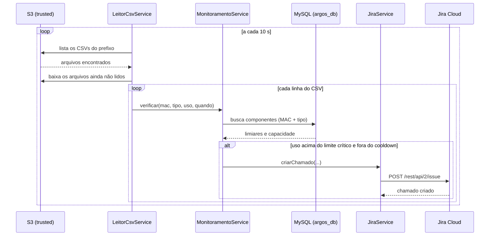

# java-jira · Alertas de hardware do Argos

Serviço em **Java / Spring Boot** que lê as métricas das máquinas monitoradas, compara com os limites cadastrados no banco e **abre automaticamente um chamado no Jira** quando um componente (CPU, RAM, disco ou rede) passa do limite crítico.

Ele é a última etapa do pipeline de monitoramento do projeto **Argos**: os scripts de Python coletam os dados, o ETL os trata, e este serviço transforma os dados em alertas.

---

## Sumário

1. [Visão geral](#1-visão-geral)
2. [Arquitetura e fluxo](#2-arquitetura-e-fluxo)
3. [Tecnologias](#3-tecnologias)
4. [Estrutura do projeto](#4-estrutura-do-projeto)
5. [Como o código funciona](#5-como-o-código-funciona)
6. [Regras de negócio](#6-regras-de-negócio)
7. [Contrato de dados (S3 e CSV)](#7-contrato-de-dados-s3-e-csv)
8. [Banco de dados](#8-banco-de-dados)
9. [Configuração](#9-configuração)
10. [Como executar](#10-como-executar)
11. [Como testar um alerta](#11-como-testar-um-alerta)
12. [Problemas comuns](#12-problemas-comuns)
13. [Limitações conhecidas e melhorias](#13-limitações-conhecidas-e-melhorias)
14. [Repositórios relacionados](#14-repositórios-relacionados)

---

## 1. Visão geral

| | |
|---|---|
| **O que faz** | Lê CSVs de métricas no S3, avalia os limites e abre chamados no Jira |
| **Gatilho** | Execução agendada a cada 10 segundos (configurável) |
| **Entrada** | CSVs da camada **trusted** do bucket S3 |
| **Consulta** | Banco MySQL `argos_db` (limites e capacidade de cada componente) |
| **Saída** | Chamado no Jira (API REST v2) |
| **Interface** | Nenhuma. É um serviço de segundo plano, sem tela e sem endpoints |

O serviço não recebe requisições. Ele fica rodando, consultando o S3 periodicamente e reagindo aos arquivos novos que aparecem.

---

## 2. Arquitetura e fluxo

### Pipeline completo do Argos

```
monitoring-scripts        ETL                      java-jira (este repo)
(captura.py)              (etlTrusted.py)
      │                        │                          │
      ▼                        ▼                          ▼
 S3 raw/...  ───────►  S3 trusted/...  ───────►  lê CSV → compara limites → abre chamado
                                                          │            ▲
                                                          ▼            │
                                                      Jira Cloud    MySQL (argos_db)
```

### O que acontece a cada ciclo



---

## 3. Tecnologias

| Item | Versão / detalhe |
|---|---|
| Java | 21 |
| Spring Boot | 4.1.1 (`spring-boot-starter-jdbc`, `spring-boot-starter-webmvc`) |
| Build | Maven (wrapper incluso: `mvnw` / `mvnw.cmd`) |
| Banco | MySQL 8, via `mysql-connector-j` e `JdbcTemplate` |
| AWS | AWS SDK v2 para Java, módulo `s3` (2.27.21), região `us-east-1` |
| Jira | API REST v2, chamada com `RestTemplate` e autenticação Basic (e-mail + API token) |
| Lombok | Usado no modelo (`@Data`, `@AllArgsConstructor`) |

---

## 4. Estrutura do projeto

```
java-jira/
├── pom.xml
├── mvnw / mvnw.cmd                      # Maven wrapper (não precisa instalar o Maven)
└── src/main/
    ├── java/com/argos/argos/
    │   ├── ArgosApplication.java        # Ponto de entrada (@EnableScheduling)
    │   ├── client/
    │   │   └── S3Provider.java          # Cria o cliente do S3
    │   ├── model/
    │   │   └── Componente.java          # Componente monitorado e seus limites
    │   ├── repository/
    │   │   └── ComponenteRepository.java  # Consulta o MySQL
    │   └── service/
    │       ├── LeitorCsvService.java    # Lê os CSVs do S3 (agendado)
    │       ├── MonitoramentoService.java  # Regra de alerta e cooldown
    │       └── JiraService.java         # Abre o chamado no Jira
    └── resources/
        ├── application.properties       # Configuração real (NÃO vai para o Git)
        └── application-example.properties  # Modelo de configuração
```

---

## 5. Como o código funciona

### `ArgosApplication`
Inicia o Spring Boot. A anotação `@EnableScheduling` é o que faz o `@Scheduled` do leitor funcionar.

### `S3Provider`
Monta o `S3Client` na região `us-east-1`. As credenciais **não ficam no código**: o SDK procura na ordem padrão da AWS (variáveis de ambiente `AWS_ACCESS_KEY_ID`, `AWS_SECRET_ACCESS_KEY` e `AWS_SESSION_TOKEN`, ou o arquivo `~/.aws/credentials` criado pelo `aws configure`).

### `LeitorCsvService` (a porta de entrada dos dados)
- Roda com `@Scheduled(fixedDelayString = "${leitor.intervalo-ms:10000}")`. Com `fixedDelay`, uma nova varredura só começa depois que a anterior terminou.
- Lista os objetos do bucket com o prefixo configurado e considera só os que terminam em `.csv`.
- Guarda em memória as chaves dos arquivos já lidos (`arquivosProcessados`) para não reler o mesmo arquivo a cada ciclo.
- Para cada arquivo: pula o cabeçalho e lê as linhas, separando as colunas **por posição** (formato fixo de 13 colunas, veja a [seção 7](#7-contrato-de-dados-s3-e-csv)).
- Para cada linha, chama o `MonitoramentoService` quatro vezes: CPU, RAM, Disco e Rede.
- Linhas com menos de 13 colunas são ignoradas, com uma mensagem no console. Valores vazios ou inválidos viram `null` e a métrica é ignorada.

### `MonitoramentoService` (a regra do alerta)
- Método `verificar(mac, tipo, uso, quando)`.
- Busca no banco os componentes daquele dispositivo (pelo MAC) e tipo.
- Compara o uso com o `limiar_critico` de cada componente. Se `uso > limiar_critico`, é um alerta crítico.
- Aplica o **cooldown** por componente (veja a [seção 6](#6-regras-de-negócio)).
- Calcula o valor e a unidade que aparecem no chamado (sempre `%`, veja abaixo) e chama o `JiraService`.

### `ComponenteRepository`
Uma única consulta, `buscarPorMacETipo(mac, tipo)`, que junta `componente`, `dispositivo` e `tipo_componente` e devolve os componentes **ativos** com capacidade e os três limiares. Retorna uma lista, porque um dispositivo pode ter mais de um componente do mesmo tipo (ex.: duas CPUs).

### `JiraService`
Monta o JSON do chamado e faz `POST {jira.url}/rest/api/2/issue` com autenticação Basic (e-mail + token). Retorna `true` se criou e `false` se falhou. O resultado é usado pelo cooldown, para só registrar o intervalo quando o chamado realmente foi aberto.

---

## 6. Regras de negócio

### Quando um alerta é disparado
Um alerta crítico acontece quando `uso > limiar_critico` do componente. Só o nível **crítico** abre chamado. Os limiares `limiar_atencao` e `limiar_alto` existem no banco, mas ainda não são usados por este serviço.

### Cooldown (anti-duplicidade)
Sem controle, uma máquina crítica por vários minutos geraria um chamado a cada leitura. Por isso, depois de abrir um chamado para um componente, o serviço **só abre outro para o mesmo componente após o tempo definido em `monitoramento.cooldown-minutos`** (recomendado: 30).

- O cooldown é por **componente**, não por máquina.
- Só começa a contar se o Jira confirmou a criação. Se o Jira estiver fora do ar, a próxima leitura crítica tenta de novo.
- Fica em memória: reiniciar o serviço zera o cooldown.

### Unidade exibida no chamado (sempre porcentagem)

| Métrica | Valor no CSV | Como aparece no chamado |
|---|---|---|
| CPU | % | `%` direto |
| RAM | % | `%` direto |
| Disco | % | `%` direto |
| Rede | Mbps (o maior entre recebida e enviada) | Convertido para `%` da **capacidade** cadastrada |

A conversão da rede é `uso × 100 ÷ capacidade`. Exemplo: 950 Mbps numa interface de 1000 Mbps aparece como `95.0 %`. Se a capacidade da rede não estiver cadastrada, o chamado mostra o valor em `Mbps`. A comparação com o limite crítico da rede continua sendo feita em Mbps.

> A coluna `unidade_medida` do banco descreve a unidade da **capacidade** (ex.: GB para disco e RAM). Por isso ela **não** é usada no texto do chamado: o valor medido está em porcentagem, e mostrar "GB" confundia quem lia o alerta.

### Conteúdo do chamado criado
- **Projeto:** `jira.project-key`
- **Tipo:** `Tarefa` (precisa ter exatamente esse nome no projeto Jira)
- **Resumo:** `ALERTA: O componente <nome> atingiu <valor> <unidade>`
- **Descrição:** informa que o limite crítico foi ultrapassado, o MAC do dispositivo e a data/hora da coleta.

---

## 7. Contrato de dados (S3 e CSV)

### Onde ficam os arquivos

```
s3://<bucket>/trusted/dispositivos/capturas/<MAC>/<AAAA>/<MM>/<DD>/dados_<MAC>_<AAAAMMDD_HHMMSS>.csv
```

Exemplo real: `bucket-argos-teste / trusted / dispositivos / capturas / 30:56:0f:06:7a:88 / 2026 / 10 / 13 /`. O leitor lista tudo o que estiver abaixo do prefixo configurado, incluindo as subpastas.

### Formato do CSV (fixo, 13 colunas)

O CSV é gerado pelo `captura.py` (repositório `monitoring-scripts`), tratado pelo ETL e lido aqui **por posição**. Se o formato mudar no Python, o `LeitorCsvService` precisa mudar junto.

| Posição | Coluna | Usada aqui? |
|:---:|---|:---:|
| 0 | `cpu total(%)` | Sim |
| 1 | `ram(%)` | Sim |
| 2 | `disco(%)` | Sim |
| 3 | `Quando foi Coletado` | Sim (vai na descrição do chamado) |
| 4 | `Rede recebida(Mbps)` | Sim |
| 5 | `Rede enviada(Mbps)` | Sim |
| 6 | `Frequencia de uso da CPU(MHz)` | Não |
| 7 | `Endereco MAC` | Sim (identifica o dispositivo) |
| 8 | `Pacotes Descartados entrada` | Não |
| 9 | `Pacotes descartados saida` | Não |
| 10 | `erros entrada` | Não |
| 11 | `erros saida` | Não |
| 12 | `perda pacotes` | Não |

Exemplo de linha:

```
39.3,71.7,95.1,2026-10-13 19:16:26,0.01,0.06,3701.0,30:56:0f:06:7a:88,85,0,0,1,25.0
```

> **Importante:** o CSV só tem as 13 colunas completas quando o dispositivo tem **CPU, RAM, Disco e Rede** cadastrados no banco. Caso contrário, as linhas saem menores que o cabeçalho e este serviço as ignora.

---

## 8. Banco de dados

O serviço só **lê** do banco `argos_db`. A estrutura é criada pelo repositório `database-scripts` (pasta DDL).

Tabelas usadas na consulta:

| Tabela | Colunas usadas |
|---|---|
| `dispositivo` | `id_dispositivo`, `endereco_mac` |
| `componente` | `id_componente`, `dispositivo_id`, `tipo_id`, `nome_identificador`, `capacidade`, `limiar_atencao`, `limiar_alto`, `limiar_critico`, `ativo` |
| `tipo_componente` | `id_tipo`, `nome`, `unidade_medida` |

### O que precisa estar cadastrado para uma máquina ser monitorada

1. O **MAC** da máquina na tabela `dispositivo` (`endereco_mac`).
2. Quatro componentes ligados a esse dispositivo, com `ativo = 1` e `limiar_critico` preenchido.
3. Os tipos precisam se chamar exatamente `CPU`, `RAM`, `Disco` e `Rede` em `tipo_componente.nome`. O código compara com esses nomes (a comparação do MySQL não diferencia maiúsculas de minúsculas, mas o nome precisa ser o mesmo).
4. Para a rede ser mostrada em `%`, preencha a `capacidade` do componente de rede (em Mbps).

Se o MAC ou os componentes não existirem, o serviço lê o arquivo normalmente, mas não encontra nada para comparar e **não gera nenhum alerta**.

---

## 9. Configuração

Toda a configuração fica em `src/main/resources/application.properties`.

> **Esse arquivo contém senhas e tokens e está no `.gitignore`. Nunca faça commit dele.** Copie o `application-example.properties` e preencha com os seus valores.

```properties
spring.application.name=argos

# Banco de dados
spring.datasource.url=jdbc:mysql://localhost:3306/argos_db?useSSL=false&allowPublicKeyRetrieval=true&serverTimezone=UTC
spring.datasource.username=SEU_USUARIO
spring.datasource.password=SUA_SENHA
spring.datasource.driver-class-name=com.mysql.cj.jdbc.Driver

# Jira
jira.url=https://SEU-DOMINIO.atlassian.net
jira.email=seu-email@exemplo.com
jira.token=SEU_API_TOKEN
jira.project-key=CHAVE_DO_PROJETO

# Leitura dos CSVs da camada trusted no S3
aws.s3.bucket=bucket-argos-teste
aws.s3.prefix=trusted/dispositivos/capturas/
leitor.intervalo-ms=10000

# Tempo mínimo entre dois chamados do mesmo componente
monitoramento.cooldown-minutos=30
```

| Propriedade | Obrigatória | Descrição |
|---|:---:|---|
| `spring.datasource.*` | Sim | Conexão com o MySQL |
| `jira.url` | Sim | Endereço do Jira, sem `/` no final |
| `jira.email` | Sim | E-mail da conta Atlassian que vai criar os chamados |
| `jira.token` | Sim | API token dessa conta |
| `jira.project-key` | Sim | Chave do projeto onde os chamados serão criados |
| `aws.s3.bucket` | Sim | Nome do bucket |
| `aws.s3.prefix` | Sim | Prefixo onde estão os CSVs da camada trusted (terminar com `/`) |
| `leitor.intervalo-ms` | Não | Intervalo entre varreduras. Padrão: `10000` (10 s) |
| `monitoramento.cooldown-minutos` | Sim | Tempo mínimo entre dois chamados do mesmo componente |

### Como obter os dados do Jira

- **API token:** em https://id.atlassian.com/manage-profile/security/api-tokens, crie um token para a conta que vai abrir os chamados. O `jira.email` deve ser o e-mail **dessa mesma conta**.
- **Chave do projeto (`project-key`):** é o código que aparece antes do número nos chamados (num chamado `KAN-11`, a chave é `KAN`). Não é o nome do projeto, e diferencia maiúsculas de minúsculas.
- **Tipo do chamado:** o código usa o tipo `Tarefa`. Se o seu projeto estiver em outro idioma (ex.: `Task`), troque o nome em `JiraService`.

### Credenciais da AWS

O serviço usa as credenciais da AWS configuradas na máquina onde ele roda:

```bash
aws configure
aws configure set aws_session_token "<token>"   # necessário no AWS Academy
aws sts get-caller-identity                     # confere se funcionou
```

No AWS Academy, as credenciais **expiram quando a sessão do laboratório termina**. Quando isso acontecer, repita o processo com as novas credenciais e reinicie o serviço.

---

## 10. Como executar

### Pré-requisitos

- Java 21
- MySQL 8 com o `argos_db` criado e populado (veja o repositório `database-scripts`)
- Credenciais da AWS com acesso de leitura ao bucket
- Conta e projeto no Jira, com API token
- Se for abrir no IntelliJ ou VS Code, ative o **plugin do Lombok** e o *annotation processing*

### Passo a passo

```bash
# 1. Clone o repositório
git clone https://github.com/Grupo-9-Projeto/java-jira.git
cd java-jira

# 2. Crie a configuração a partir do modelo e preencha os valores
cp src/main/resources/application-example.properties src/main/resources/application.properties

# 3. Execute (Windows: .\mvnw.cmd spring-boot:run)
./mvnw spring-boot:run
```

Para gerar o `.jar` e rodar sem o Maven:

```bash
./mvnw clean package -DskipTests
java -jar target/argos-0.0.1-SNAPSHOT.jar
```

Ao subir, o Spring Boot inicia também um servidor web na porta 8080 (por causa da dependência `webmvc`), mas o serviço não expõe nenhum endpoint.

### O que você deve ver no console

```
Arquivo trusted/dispositivos/capturas/30:56:0f:06:7a:88/2026/10/13/dados_...csv ...
Componente CPU Total estável.
ALERTA CRÍTICO: Memória RAM passou do limite! Uso atual: 71.7 %
Tentando abrir chamado no Jira para o componente Memória RAM
✅ Chamado criado com sucesso! Status: 201 CREATED
Chamado já aberto recentemente para Memória RAM. Novo chamado só depois de 30 min.
```

---

## 11. Como testar um alerta

Para ver o fluxo completo funcionando sem esperar a máquina chegar ao limite:

1. Deixe o monitoramento (`captura.py`) e o ETL gerando arquivos na camada trusted.
2. Descubra o componente que você quer forçar:

```sql
SELECT c.id_componente, c.nome_identificador, c.limiar_critico
FROM componente c
JOIN dispositivo d ON d.id_dispositivo = c.dispositivo_id
WHERE d.endereco_mac = 'SEU_MAC';
```

3. Baixe o limite crítico para um valor abaixo do uso atual (ex.: RAM em 50):

```sql
UPDATE componente SET limiar_critico = 50 WHERE id_componente = <ID_DO_COMPONENTE>;
```

4. Suba o serviço. Em até alguns ciclos aparece `ALERTA CRÍTICO` e o chamado no Jira.
5. Para repetir o teste, aguarde o cooldown ou reinicie o serviço.
6. **Volte o limite ao valor original** quando terminar.

---

## 12. Problemas comuns

| Sintoma | Causa provável | Solução |
|---|---|---|
| `Public Key Retrieval is not allowed` | Conexão sem SSL com o MySQL 8 | Adicione `allowPublicKeyRetrieval=true` na URL do banco |
| `Authentication plugin 'caching_sha2_password' is not supported` | Driver MySQL antigo | Use o `mysql-connector-j` atual (já está no `pom.xml`) |
| `400 Bad Request ... O projeto de destino não existe ou você não tem permissão` | `jira.project-key` errada, ou a conta do token sem acesso ao projeto | Confira a chave e use o e-mail/token da conta que enxerga o projeto |
| Erro de Jira falando do tipo de item (`issuetype`) | O nome do tipo no seu projeto não é `Tarefa` | Troque o nome no `JiraService` (ex.: `Task`) |
| `Could not resolve placeholder 'monitoramento.cooldown-minutos'` (ou outra chave) | Propriedade faltando no seu `application.properties` | Compare com o `application-example.properties` |
| Nada acontece e o console mostra erro ao listar o bucket | Credenciais da AWS expiradas, bucket ou prefixo errado | Renove as credenciais (`aws configure`) e confira `aws.s3.*` |
| `Linha ignorada ... esperava 13 colunas` | Dispositivo sem os 4 componentes cadastrados | Cadastre CPU, RAM, Disco e Rede para o MAC |
| Arquivos são lidos mas não aparece nenhuma linha `Componente ... estável` | MAC não cadastrado em `dispositivo`, ou sem componentes ativos | Confira os cadastros da [seção 8](#8-banco-de-dados) |
| Chamado diz `GB` em vez de `%` | Versão antiga do `MonitoramentoService` | Atualize o código para a versão que usa `valorExibido` / `unidadeExibida` |
| Alertas pararam de chegar depois de muitas horas | Limite de 1000 objetos por listagem do S3 | Veja a [seção 13](#13-limitações-conhecidas-e-melhorias) |

---

## 13. Limitações conhecidas e melhorias

**Limitações atuais**

- **Estado em memória:** a lista de arquivos já lidos e o cooldown se perdem ao reiniciar. Depois de uma reinicialização, os arquivos antigos são lidos de novo, e cada componente pode abrir um chamado (no máximo um por cooldown).
- **Listagem do S3:** o S3 devolve no máximo 1000 objetos por chamada de listagem. Como entra um arquivo novo a cada ~30 s por máquina, depois de algumas horas é preciso listar com paginação (`listObjectsV2Paginator`). Confira no `LeitorCsvService` se isso está aplicado.
- **Só o nível crítico gera chamado:** `limiar_atencao` e `limiar_alto` ainda não são usados.
- **Formato do CSV fixo:** leitura por posição. Mudanças no `captura.py` ou no ETL exigem mudança aqui.
- **Uma consulta ao banco por métrica de cada linha:** funciona bem para poucas máquinas, mas é o primeiro ponto a otimizar se o volume crescer.
- **JSON montado como texto:** nomes de componentes com aspas ou barras invertidas quebrariam o corpo da requisição ao Jira.
- **Tipo de chamado fixo:** `Tarefa`.

**Ideias de evolução**

- Gravar cada alerta na tabela `Alerta` do banco (hoje ela existe, mas este serviço não escreve nela).
- Abrir chamados também para os níveis `alto` e `atencao`, com prioridades diferentes.
- Guardar os arquivos já processados e os cooldowns no banco, ou mover os arquivos lidos para outro prefixo do S3.
- Associar o chamado ao contrato de SLA da empresa cliente (prioridade e prazo de resposta).
- Trocar os `System.out.println` por um logger com níveis.

---

## 14. Repositórios relacionados

| Repositório | Papel |
|---|---|
| [monitoring-scripts](https://github.com/Grupo-9-Projeto/monitoring-scripts) | Coleta as métricas da máquina (`captura.py`) e roda o ETL (raw → trusted → client) |
| `database-scripts` | Scripts SQL do banco `argos_db` (DDL, DML e modelagem) |
| [web-data-viz](https://github.com/Grupo-9-Projeto/web-data-viz) | Back-end em Node.js |
| [site-institucional](https://github.com/Grupo-9-Projeto/site-institucional) | Front-end |
| [java-spring-email](https://github.com/Grupo-9-Projeto/java-spring-email) | Serviço de envio de e-mail e cadastro de usuários |
